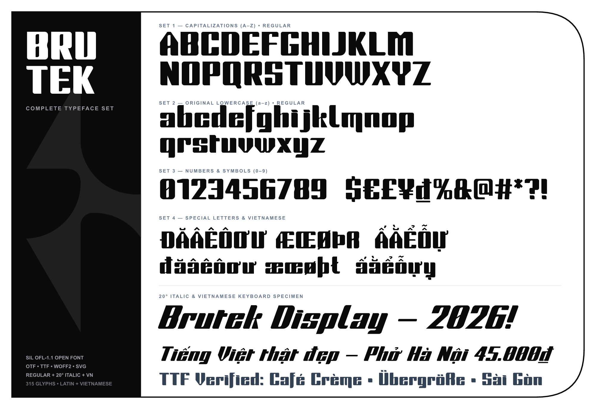
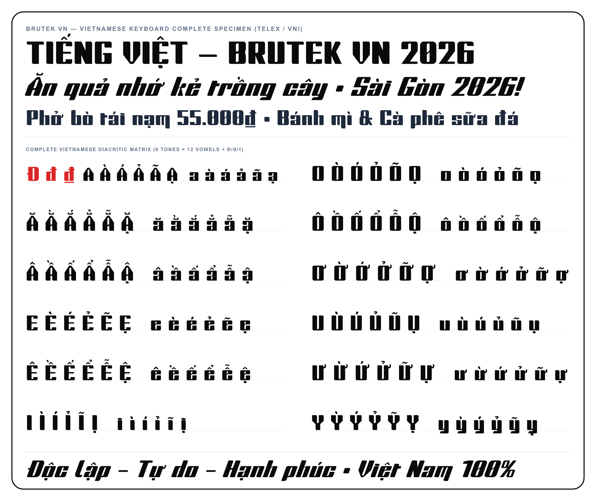

# Brutek — Modular Neo-Brutalist Display Typeface

**Brutek** is a bold modular neo-brutalist display typeface featuring heavy vertical slabs, crisp horizontal bars, signature asymmetric counter slits, chamfered diagonal wedges, and a **20° Italic** cut — complete with **315 glyphs** per style covering **Extended Latin** and full **Vietnamese Keyboard (Telex / VNI)** support.



## Design DNA
- **Original Lowercase (`a–z`)**: Losslessly extracted from `source/TYPOGRAPHY101.ai` preserving the exact original cubic Bézier geometry, `216 × 216` lowercase module, `93–94u` ultra-heavy vertical stems, `24u` horizontal bars, and `30u` signature asymmetric counter slits.
- **Capitalizations (`A–Z`) & Numerals (`0–9`)**: Engineered at `324u` cap/figure height (`100u` stems, `28u` bars, `40u` asymmetric counter slits) with C1-smooth curves, selective directional corner rounding, and chamfered wedges (`A, V, W, Y`).
- **Special Letters & Extended Latin**: Bespoke `ß, Æ, æ, Œ, œ, Ø, ø, Ð, ð, Þ, þ, Ł, ł` plus Western/Central European accented letters and matching punctuation, math, and currency symbols.
- **Vietnamese Edition (`Brutek VN`)**: All 135 Vietnamese characters (`Đ, đ, ₫`, plus all 6 tones across `A, Ă, Â, E, Ê, I, O, Ô, Ơ, U, Ư, Y` upper & lower) with authentic side-nested circumflex + tone diacritics and upward-curling attached horns (`Ơ, ơ, Ư, ư`).
- **20° Italic**: True `20°` oblique slant matching the original specimen artwork.



---

## Downloads & Installation

Grab the ready-to-use ZIP archive from `release/Brutek-Complete-Font-Pack.zip` (or the [GitHub Releases](../../releases) page), or install directly from `dist/`:

### Font Families Included (315 Glyphs Each)
| Family | Style | OTF (Print / Design) | TTF (Desktop / Office) | WOFF2 (Web) |
| --- | --- | --- | --- | --- |
| **Brutek** | Regular | `dist/Brutek-Regular.otf` | `dist/Brutek-Regular.ttf` | `dist/Brutek-Regular.woff2` |
| **Brutek** | 20° Italic | `dist/Brutek-Italic.otf` | `dist/Brutek-Italic.ttf` | `dist/Brutek-Italic.woff2` |
| **Brutek VN** | Regular | `dist/BrutekVN-Regular.otf` | `dist/BrutekVN-Regular.ttf` | `dist/BrutekVN-Regular.woff2` |
| **Brutek VN** | 20° Italic | `dist/BrutekVN-Italic.otf` | `dist/BrutekVN-Italic.ttf` | `dist/BrutekVN-Italic.woff2` |

> Both **Brutek** and **Brutek VN** include full English, Extended Latin, and Vietnamese (Telex / VNI) support.

### Installing on Windows / macOS
- **Windows**: Select the `.otf` (or `.ttf`) files in `dist/`, right-click → **Install** (or double-click each file and click **Install**).
- **macOS**: Double-click the `.otf` files to open in **Font Book** and click **Install Font**.

---

## Project Structure
- `dist/` — Compiled installable fonts (`.otf`, `.ttf`, `.woff2`)
- `vectors/` — Adobe Illustrator-ready organized SVG sets (`set1` through `set6`) + `vectors/glyphs/` (312 individual clean SVG glyphs)
- `specimens/` — High-resolution specimen posters (PNG & SVG) and OTF/TTF binary verification proof
- `demo/index.html` — Interactive browser live type-tester (English & Tiếng Việt presets, Regular/Italic toggle, size & tracking sliders)
- `source/TYPOGRAPHY101.ai` — Original Adobe Illustrator source artwork
- `src/` — Modular vector geometry engine, glyph definitions, optical metrics/kerning, and font/specimen build scripts
- `release/Brutek-Complete-Font-Pack.zip` — Complete zipped distribution pack

---

## Rebuilding from Source
```bash
npm install
npm run build
```

---

## License

Copyright (c) 2026 **Dieu Anh** — licensed under the **[SIL Open Font License, Version 1.1 (OFL-1.1)](LICENSE)** with Reserved Font Names `"Brutek"` and `"Brutek VN"`.

- **Free for personal & commercial use**: You may use, embed, bundle, and print documents/websites/apps using these fonts freely.
- **No standalone resale**: Neither the original nor modified font files may be sold by themselves.
- **Reserved Font Names**: Any modified/forked versions must use a different font name and remain licensed under OFL-1.1.
- Full license text: [LICENSE](LICENSE) / [OFL.txt](OFL.txt).
